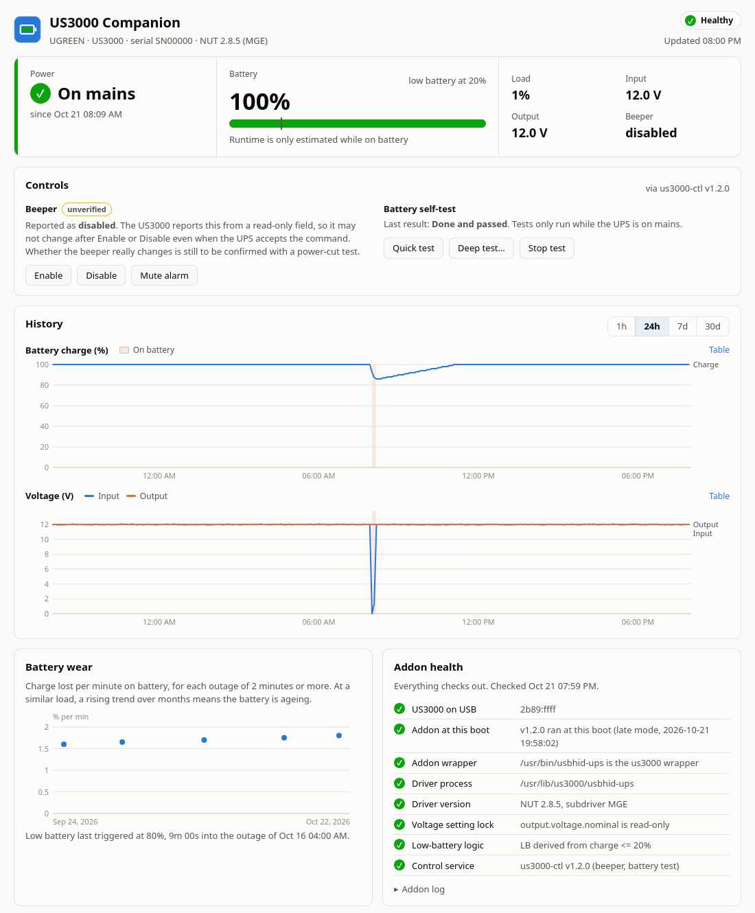

# UGREEN US3000 UPS on Synology DSM

**UGREEN's US3000 support, reverse-engineered from UGREEN's own firmware and
rebuilt for Synology DSM.**

The UGREEN US3000 DC UPS is only officially supported by UGREEN's own NAS
operating system, UGOS. Plugged into a NAS running Synology DSM, it isn't
recognised at all. To find out exactly how UGREEN drives it, this project took
apart UGREEN's official firmware: the **UGOS Pro 1.20.0.142** NAS image and the
**US3000 V3.7** UPS firmware. It then recreated that behaviour on top of DSM's
built-in UPS support, using only open-source components (Network UPS Tools).

What the firmware revealed, and what this project does with it:

- **How UGOS talks to the UPS.** UGOS's custom "TOP HID" driver turned out to be
  NUT's MGE mapping under another name. The addon uses the same mapping, so DSM
  sees everything UGOS sees.
- **How UGOS decides to shut down.** UGOS ignores the UPS's own low-battery flag
  and works from the charge percentage. The addon does the same.
- **What must never be touched.** UGOS appears to set the UPS's DC output voltage
  through one variable. The addon locks it read-only, so nothing on DSM can
  change it.
- **Which hardware variants exist.** Two suppliers build the US3000 (USB IDs
  `2b89:ffff` and `2b89:3245`). The addon recognises both.

The details are in [Reverse engineering UGREEN's firmware](#reverse-engineering-ugreens-firmware).
No UGREEN firmware, code or files are redistributed.

It works on genuine Synology NAS hardware and on machines running DSM through
the [RR loader](https://github.com/RROrg/rr) (XPEnology), and comes with a DSM
companion app that shows what DSM's own UPS page doesn't:

- **RR / XPEnology:** install it as an RR addon ([step 1](#1-the-addon)).
- **Genuine Synology:** run the same script from a Task Scheduler boot task
  ([step 1b](#1b-without-rr-genuine-synology-task-scheduler)). x86_64 models only,
  and not yet tested on real Synology hardware.

> Unofficial and not affiliated with UGREEN or Synology. A UPS decides when your
> NAS loses power: test it (pull the plug while watching) before you rely on it.

> **AI-generated code.** This project (the addon, the companion app, the tests and
> this README) was written by a generative AI assistant (Anthropic's Claude) under
> human direction. It has been tested on real hardware only as far as the Status
> section says, and has not had a line-by-line human code review. Read the scripts
> before you run them as root, and report anything that looks wrong.

**Status.** Developed on a UGREEN DXP4800S (DSM 7.4.1-90080, RR 26.9.0) with a
US3000 reporting USB ID `2b89:ffff`. Tested so far:

- the addon's `install.sh` applied to a running DSM, and its install, uninstall
  and idempotency checked against a copy of DSM's files;
- DSM's UPS service with the 2.8.5 driver, including a real power cut (on
  battery, then back on mains);
- the companion package installed through Package Center.

**Not yet tested:** installing the addon through the RR menu and booting with it,
the Task Scheduler method for systems without RR (offline tests only), and a full
low-battery shutdown.

| Part | What it is |
|---|---|
| [`addon/`](addon) | Gets DSM's UPS service to drive the US3000 (RR addon, or Task Scheduler boot task) |
| [`companion/`](companion) | DSM package: live status, outage history, battery-wear trend, addon health |


*(Screenshot with simulated data.)*

## Reverse engineering UGREEN's firmware

Every US3000-specific decision in this project comes from UGREEN's own firmware.
The aim was compatibility: make the UPS behave on DSM the way UGREEN designed it
to behave on UGOS.

**Sources.** Both are official files published by UGREEN:

| File | What it is |
|---|---|
| UGOS Pro 1.20.0.142 (`…intel_release_amd64_6.18_nasync.img`) | UGREEN's NAS operating system |
| `US3000_TB_V3.7_US3000_JQH_V3.7_20260907.bin` | US3000 UPS firmware V3.7, one build per hardware supplier |

**Method.** The files were only unpacked and read. Nothing from them was run, and
nothing was flashed to the UPS.

- The UGOS image was unpacked layer by layer (tar, squashfs, UGREEN's signed
  package format, gzip, xz) down to the UPS-related binaries.
- In the UPS firmware, the USB device and HID report descriptors were located and
  decoded.
- UGOS's NUT driver was parsed as an ELF file to extract its subdriver tables,
  which were then compared with NUT's own.
- UGREEN's UPS service binaries (`ups_tool`, `ctl_serv`) were searched for the
  configuration and commands they use.

**Findings, and what the addon does with them:**

| Found in | Finding | Used as |
|---|---|---|
| UPS firmware | The report descriptor (1044 bytes for the TB variant) lists every value the UPS offers, and which ones the host may change | Identifying a unit's variant; knowing which settings are writable |
| UPS firmware | The JQH build uses USB ID `2b89:3245`; the TB build is `2b89:ffff` | Both IDs are whitelisted |
| UGOS NUT driver | UGREEN's "TOP HID" subdriver mapping is identical to NUT's MGE subdriver, apart from one default delay | [`subdriver=MGE`](#driver-settings-and-why) |
| UGOS `ups_tool` | UGOS writes `ignorelb` plus its own `override.battery.charge.low`, and forces a shutdown at ≤5% charge | `ignorelb` with `battery.charge.low=20` |
| UGOS `ups_tool` | UGOS has a "set voltage" UPS event and handles `output.voltage.nominal`, which points to it setting the UPS's DC output voltage (inferred from the binaries, not observed) | That variable is locked read-only |
| UGOS udev rules | UGOS labels the two IDs "TOP" and "UC300" | Documentation |

**Left alone on purpose.** UGOS also updates the UPS's own firmware (`ctl_serv`
checks `ups.json` and the md5 sums, picks the TB or JQH file, and uploads it in
chunks). That flashing protocol was not decoded, and this project never flashes
the UPS: a failed flash would brick it, and the NAS would lose power with it.

No UGREEN firmware, code or files are included in this repository or its
releases. Everything shipped is either original code or unmodified Network UPS
Tools.

## Why an addon is needed

DSM 7.4 ships NUT 2.8.0. The US3000 is a standard HID power device, but NUT 2.8.0
has no matching subdriver for its vendor ID (`2b89`), and it has no `subdriver`
option to force one. DSM also only starts its UPS service for USB IDs on its own
whitelist. The addon:

1. bundles a static **NUT 2.8.5** `usbhid-ups` built with DSM's paths;
2. wraps DSM's `/usr/bin/usbhid-ups` so the US3000 gets the 2.8.5 driver and any
   other UPS still gets DSM's own driver;
3. adds `2b89:ffff` and `2b89:3245` to DSM's UPS whitelist
   (`/lib/udev/devicetable/usb.nut-hid`) and driver table (`/etc/ups/nutscan-usb.h`).

It reapplies itself on every boot, so it survives DSM updates. Uninstalling it
restores every file it touched.

### Driver settings and why

- **`subdriver=MGE`.** UGREEN's own NAS OS (UGOS) drives the US3000 with NUT plus
  a "TOP HID" subdriver. Its mapping table is identical to NUT's MGE subdriver,
  so MGE exposes everything UGOS sees, including the beeper and battery-test
  commands.
- **`ignorelb` + `battery.charge.low=20`.** UGOS ignores the UPS's own low-battery
  flag too, and derives it from the charge percentage instead.
- **Read-only overrides.** `output.voltage.nominal` is locked, because UGOS appears
  to use it to *set the DC output voltage*, and a wrong value could damage the NAS.
  `input.transfer.*` (AC-only, meaningless on a DC unit) and the model name
  (the firmware returns a garbled suffix) are locked as well.

### US3000 quirks

- It reports `DISCHRG` even on mains with a full battery. Harmless; never set
  `onlinedischarge`, or DSM would treat that as a power cut.
- `battery.runtime` is `65535` ("unknown") on mains. It only estimates runtime
  on battery.
- The beeper is disabled by default (`ups.beeper.status: disabled`).
- There are two hardware suppliers: "TB" (`2b89:ffff`) and "JQH" (`2b89:3245`,
  called "UC300" in UGOS). Only the TB variant has been tested.

## Install

### 1. The addon

1. Download `us3000.addon` from the [latest release](../../releases/latest).
2. In the RR menu: **Addons → Upload a external addon**, choose the file.
3. Enable `us3000` under **Add an addon**, rebuild the loader and boot.
4. In DSM: **Control Panel → Hardware & Power → UPS**, tick **Enable UPS support**
   with type **USB UPS**.
5. Check `/var/log/rr-us3000.log`, then pull the UPS's mains plug and watch
   DSM report the switch to battery.

Optional addon parameters are passed to the driver, for example `-x pollinterval=5`.

### 1b. Without RR (genuine Synology): Task Scheduler

**Untested on genuine Synology hardware.** The released driver is **x86_64 only**,
so this won't work on ARM models (check **Control Panel → Info Center → CPU**).
The same `install.sh` can run from a root boot task instead of from RR:

1. Make a folder on a volume, e.g. `/volume1/us3000`. Put `install.sh` from this
   repo there, plus the driver from the release's `us3000.addon`:
   ```sh
   cd /volume1/us3000
   curl -fsSLo install.sh https://raw.githubusercontent.com/mooseses/us3000-dsm/main/addon/install.sh
   tar -xzf us3000.addon ./all.tgz && tar -xzf all.tgz ./us3000-usbhid-ups && rm all.tgz
   ```
2. **Control Panel → Task Scheduler → Create → Triggered Task → User-defined
   script.** Set **User** to `root`, **Event** to `Boot-up`, and the command to
   `sh /volume1/us3000/install.sh boot`.
3. Select the task and click **Run** once, then enable UPS support in DSM
   (step 4 above).

**Difference from RR.** RR patches DSM before it detects USB devices. A boot-up
task runs afterwards, once DSM has already rejected the UPS, so `boot` mode replays
the UPS's USB "add" event (`udevadm trigger`) after patching. The UPS isn't
monitored for the first minute or two of each boot.

**To uninstall:** turn off UPS support, delete the task, run
`sh /volume1/us3000/install.sh boot-uninstall` as root, then reboot.

### 2. The companion app (optional)

1. Download `us3000-companion-<version>-noarch.spk` from the release.
2. **Package Center → Settings → Trust level → Any publisher** (the package is
   unsigned).
3. **Package Center → Manual Install**, choose the `.spk`.
4. Open **US3000 Companion** from the main menu (administrators only).

The app is read-only: it reads DSM's `upsd` and never sends commands to the UPS.
It needs no extra packages (it uses DSM's built-in Python 3.8). Raw readings are
kept for 30 days and outage records are kept forever.

## Build from source

```sh
# Addon: the driver needs an Alpine environment for a fully static musl build
docker run --rm -v "$PWD":/w -w /w alpine:3.24 sh addon/build-driver.sh
sh addon/package.sh                       # -> addon/dist/us3000.addon

# Companion: run on DSM (or anywhere with python3, tar and md5sum)
sh companion/build.sh                     # -> companion/dist/*.spk
python3 -I companion/tests/test_backend.py
```

Rebuilt drivers are functionally identical but not byte-identical to the
released one (the compiler records build paths).

DSM loads `<app folder>/style.css` from **every** running package into its own
desktop page. That's why the companion's stylesheet is called `app.css`, and why
`build.sh` refuses to build if a `style.css` appears.

## Licence

MIT for this repository's code (see [LICENSE](LICENSE)). The `usbhid-ups` binary
inside the released `us3000.addon` is
[Network UPS Tools](https://github.com/networkupstools/nut) 2.8.5, licensed
GPL-2.0-or-later. It's built unmodified from the upstream release tarball by
[`addon/build-driver.sh`](addon/build-driver.sh).
